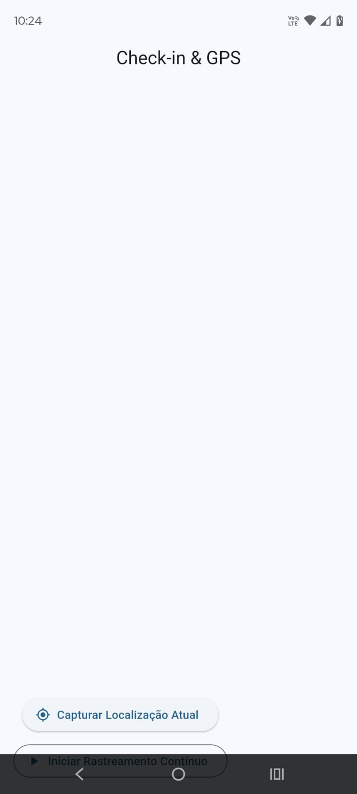
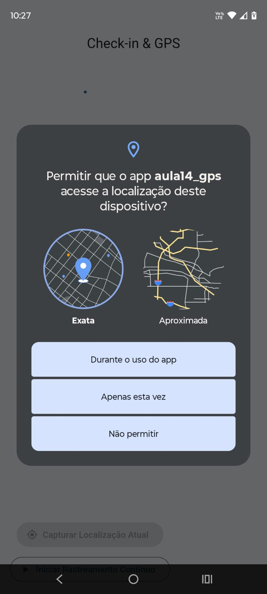
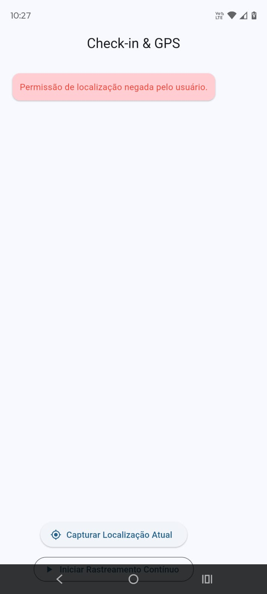
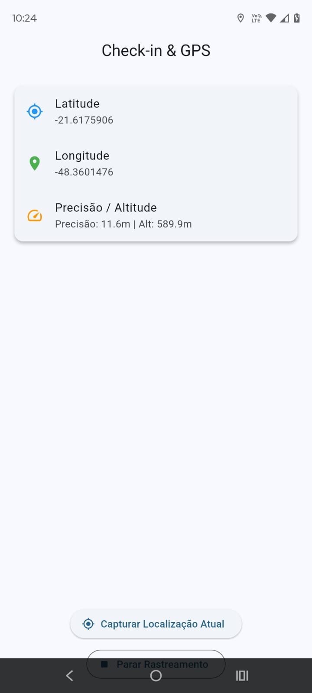
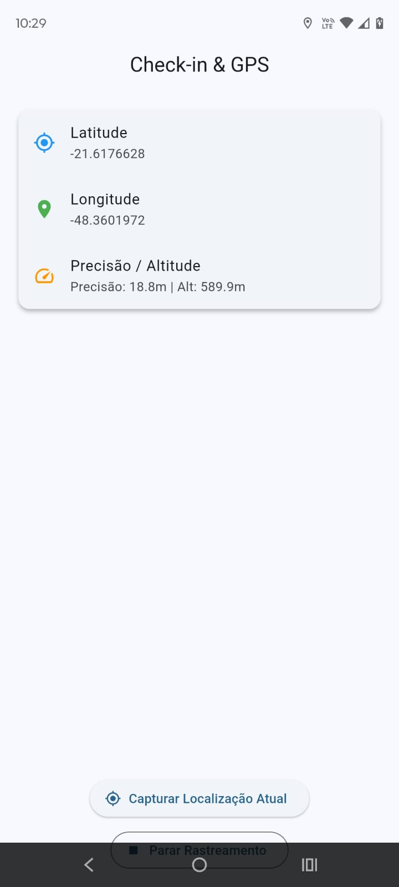
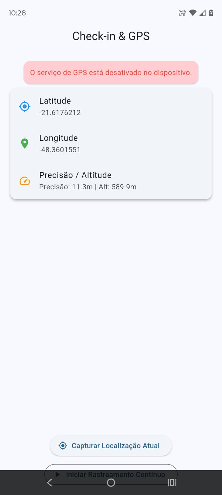
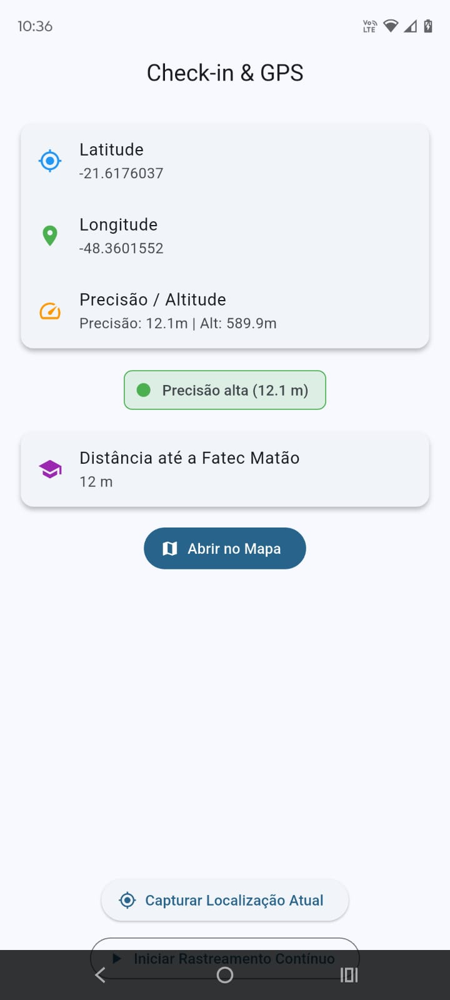
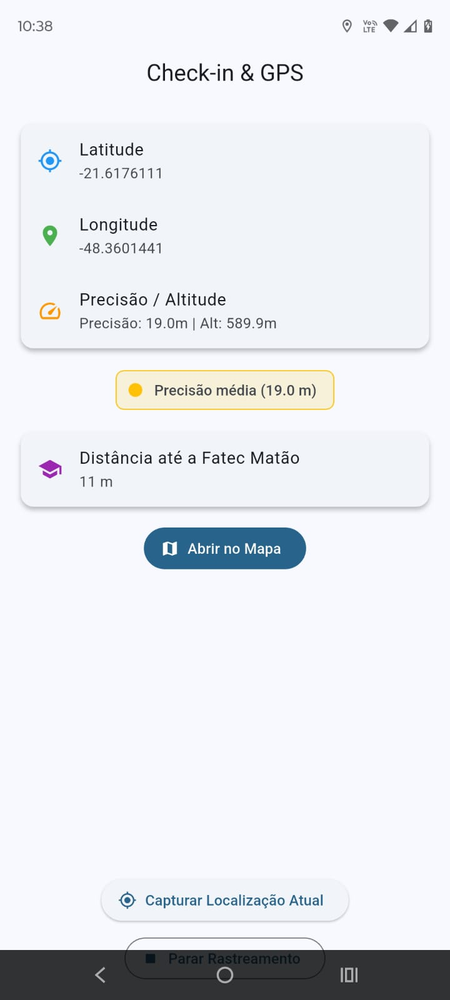
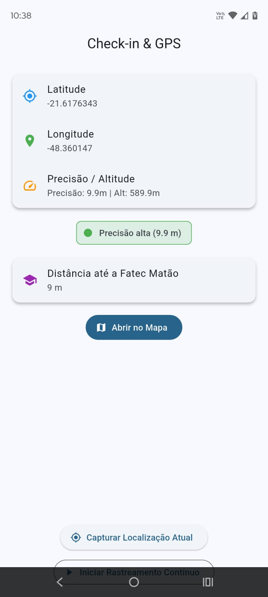
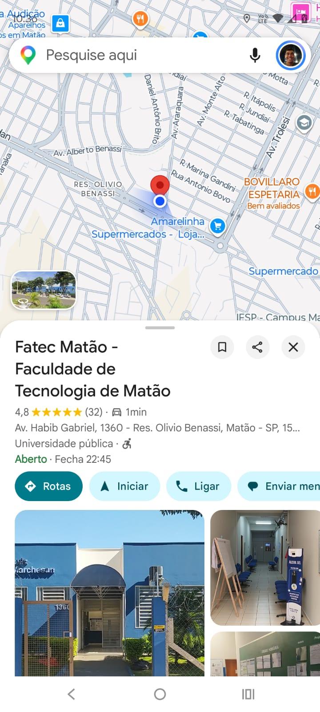

# Aula 14 — Check-in & GPS: Geolocalização no Flutter

Aplicativo Flutter que acessa o GPS do celular para capturar e rastrear a localização do usuário, com tratamento de permissões e de serviço desativado, desenvolvido no roteiro prático da Aula 14.

| | |
|---|---|
| **Aluno** | Henrique Tavares Andrade |
| **Disciplina** | Programação para Dispositivos Móveis I |
| **Professor** | Diego Menegassi |
| **Semestre** | 2026/2 |

## Funcionalidades

| Recurso | Mecanismo | Ação no app |
|---|---|---|
| **Permissões nativas** | `AndroidManifest.xml` | Declara acesso à localização precisa (`FINE`) e aproximada (`COARSE`) |
| **Checagem de serviço** | `Geolocator.isLocationServiceEnabled()` | Avisa o usuário se o GPS estiver desligado |
| **Solicitação de acesso** | `Geolocator.requestPermission()` | Exibe o diálogo nativo e trata recusa e recusa permanente |
| **Captura única** | `Geolocator.getCurrentPosition()` | Mostra latitude, longitude, precisão e altitude |
| **Rastreamento contínuo** | `Geolocator.getPositionStream()` | Atualiza a tela a cada 10 metros percorridos |

Erros de permissão e de GPS desativado aparecem em um card vermelho com mensagem amigável, sem travar o aplicativo. O Stream de posição é cancelado no `dispose()` para não consumir bateria em segundo plano.

## Desafios implementados

Foram implementados os três níveis de desafio do roteiro:

- **Básico — Medidor de Precisão:** um chip colorido indica a qualidade do sinal: verde para precisão menor que 15 m, amarelo entre 15 e 50 m e vermelho acima de 50 m.
- **Intermediário — Cálculo de Distância:** usa `Geolocator.distanceBetween()` para mostrar a distância em linha reta até a Fatec Matão, em metros ou quilômetros. Com o rastreamento ligado, o valor é atualizado enquanto o usuário se desloca.
- **Avançado — Abrir no Google Maps:** um botão usa o pacote `url_launcher` para abrir a posição atual em `https://maps.google.com/?q=lat,lng`.

## Tecnologias

- [Flutter](https://flutter.dev) / Dart
- [geolocator](https://pub.dev/packages/geolocator) — acesso ao GPS, permissões e cálculo de distância
- [url_launcher](https://pub.dev/packages/url_launcher) — abertura de links externos
- Material 3

## Arquitetura

```
lib/
├── services/
│   └── location_service.dart       # Validação de permissões, captura única e Stream de posição
├── screens/
│   └── geolocalizacao_screen.dart  # Interface, estados de carregamento/erro e desafios
└── main.dart                       # Ponto de entrada do app
```

- **LocationService:** isola a comunicação com o hardware. O método `verificarPermissoes()` checa se o GPS está ligado e se há permissão, e é usado tanto pela captura única quanto pelo rastreamento.
- **GeolocalizacaoScreen:** controla três estados da tela (carregando, erro e posição) e atualiza a interface com `setState` a cada leitura do GPS.

## Como executar

```bash
git clone URL_DO_REPOSITORIO
cd aula14_gps
flutter pub get
flutter run
```

> Recomenda-se executar em um celular físico, pois o GPS do emulador é simulado. Ao abrir, permita o acesso à localização "Durante o uso do app".

## Screenshots

### Roteiro base

<table>
  <tr>
    <td align="center"><br><sub>Tela inicial</sub></td>
    <td align="center"><br><sub>Pedido de permissão</sub></td>
    <td align="center"><br><sub>Permissão negada</sub></td>
    <td align="center"><br><sub>Captura de coordenadas</sub></td>
  </tr>
  <tr>
    <td align="center"><br><sub>Rastreamento ligado</sub></td>
    <td align="center"><br><sub>Posição atualizada pelo Stream</sub></td>
    <td align="center"><br><sub>GPS desativado</sub></td>
    <td></td>
  </tr>
</table>

### Desafios

<table>
  <tr>
    <td align="center"><br><sub>Precisão alta e distância até a Fatec</sub></td>
    <td align="center"><br><sub>Precisão média com rastreamento</sub></td>
    <td align="center"><br><sub>Distância atualizada</sub></td>
    <td align="center"><br><sub>Posição aberta no Google Maps</sub></td>
  </tr>
</table>